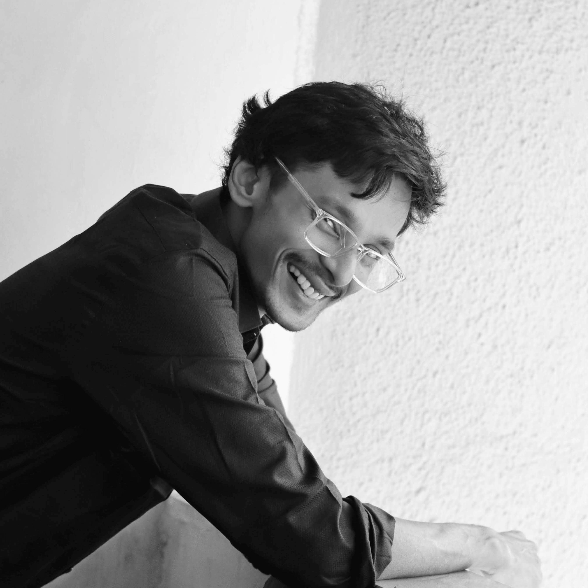
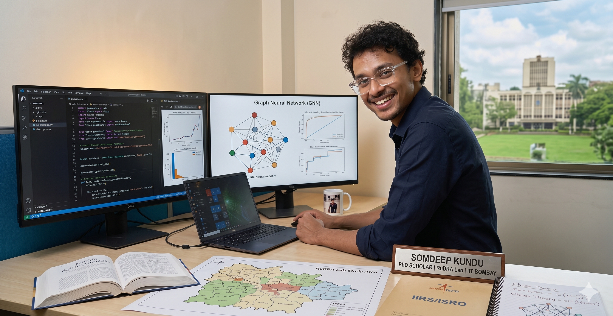

---
hide:
  - toc
og:
  image: assets/images/social-card.jpg
  image_alt: "Somdeep Kundu: geospatial portfolio, map layers of terrain, crops and night lights"
---

  <a class="cv-pill" href="projects/cropview/">
    
    New
    CropView v3.4 LTR: every field photo, mapped as a footprint
    →
  </a>

  
  

    <h1>Somdeep Kundu</h1>
    
<strong>PhD Scholar, IIT Bombay | RuDRA Lab, C-TARA</strong>

    
<em>Generalised Abstract Spatio-temporal madness</em>

  

---

## About Me

I am a PhD Scholar at the Centre for Technology Alternatives for Rural Areas (C-TARA) at Indian Institute of Technology, Bombay, and part of the RuDRA (Rural Data Research Analysis) Lab. Building on my background in Civil Engineering and a PG diploma in Disaster Management with Remote Sensing & GIS from IIRS, ISRO, my work addresses agricultural water optimization for rural Maharashtra, especially for small holding farmers in this extreme times of rainfall vulnerability. My methodology centers on field-operationalizable approaches, learning from bottom up, need assessment then implement hydrological modeling rather than purely theoretical machine learning. By integrating ancient agrometeorology with multimodal satellite data (such as NISAR and Sentinel) and multi-temporal ground-truthing from inhouse built CropView v2.0 app, I utilize Python, QGIS, and Google Earth Engine to translate complex geospatial data into actionable rural applications. 

  
  
<a href="https://somdeepkundu.github.io/assets/files/IndiaAI-ImpactSummit-Somdeep.pdf" target="_blank" rel="noopener">View IndiaAI Summit poster →</a>

---

[View My Projects :material-arrow-right:](projects/index.md){ .md-button .md-button--primary }
[Download CV :material-download:](assets/Somdeep-Kundu-CV.pdf){ .md-button }

---

## Skills

-   :material-layers:{ .lg .middle } **GIS & Remote Sensing**

    ---

    - Google Earth Engine, QGIS
    - GDAL / OGR — Drone data spatial analysis with open-source tools
    - STAC API for satellite data integration
    - DGCA-approved certified drone pilot (Rotorcraft, VLOS, Small)

-   :material-code-braces:{ .lg .middle } **Programming**

    ---

    - Python — Machine Learning & Automation
    - R — Spatial Data Analysis
    - JavaScript — Web mapping & GEE
    - HTML, CSS — Web Development
    - Natural Language / Vibe Coding — Agentic Workflow
    - Parallel processing using Dask and XArray

-   :material-star-four-points:{ .lg .middle } **Machine Learning & GeoAI**

    ---

    - Linear Algebra, Bayesian Statistics
    - Classical and non-Markovian hybrid approach
    - Post-classification accuracy assessment
    - Time-series spatial data processing and gap filling
    - Foundational Model (Alpha Earth)
    - Graph Neural Networks (GNN), Knowledge Graph
    - Sustainable and Trustworthy AI
    - Chaos Theory applications in agrometeorology

-   :material-earth:{ .lg .middle } **Web Mapping & Applications**

    ---

    - Streamlit for data-driven web apps and dashboards
    - Interactive web-based application development (GEE apps, GitHub.io)
    - Integrating indigenous knowledge systems with spatial data
    - Multiband spatiotemporal remote sensing data visualization
    - Static and dynamic web development

-   :material-account-group:{ .lg .middle } **Social & Emotional Skills**

    ---

    - Highly motivated
    - Working on technology alternative for Rural Areas
    - Communication skills and active leadership experiences
    - Evidence-based policy evaluation studies
    - Qualitative research, Auto-Ethnography

---

## Connect

[GitHub](https://github.com/somdeepkundu){ .md-button }
[LinkedIn](https://linkedin.com/in/somdeep-kundu){ .md-button }
[ResearchGate](https://www.researchgate.net/profile/Somdeep-Kundu-2){ .md-button } 
[Website](https://www.somdeepkundu.in/){ .md-button }
