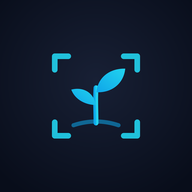
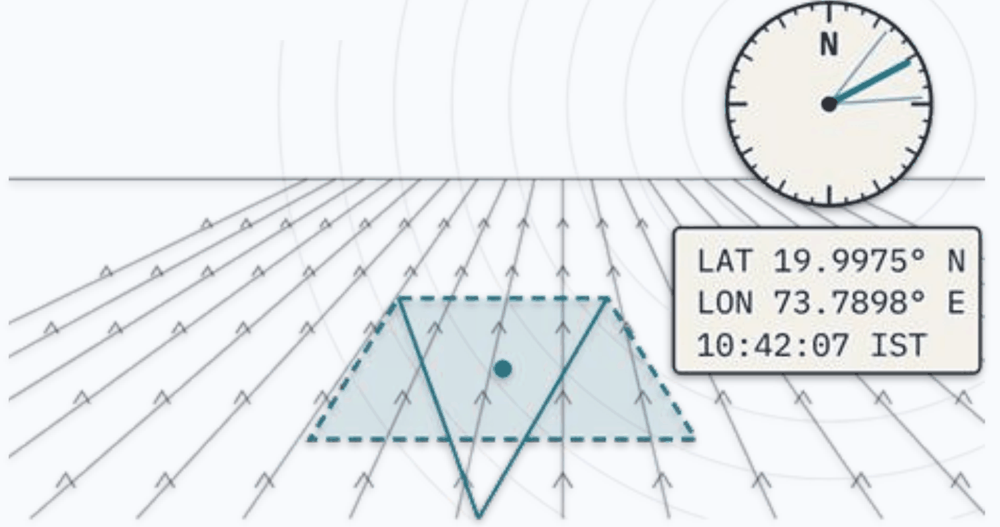
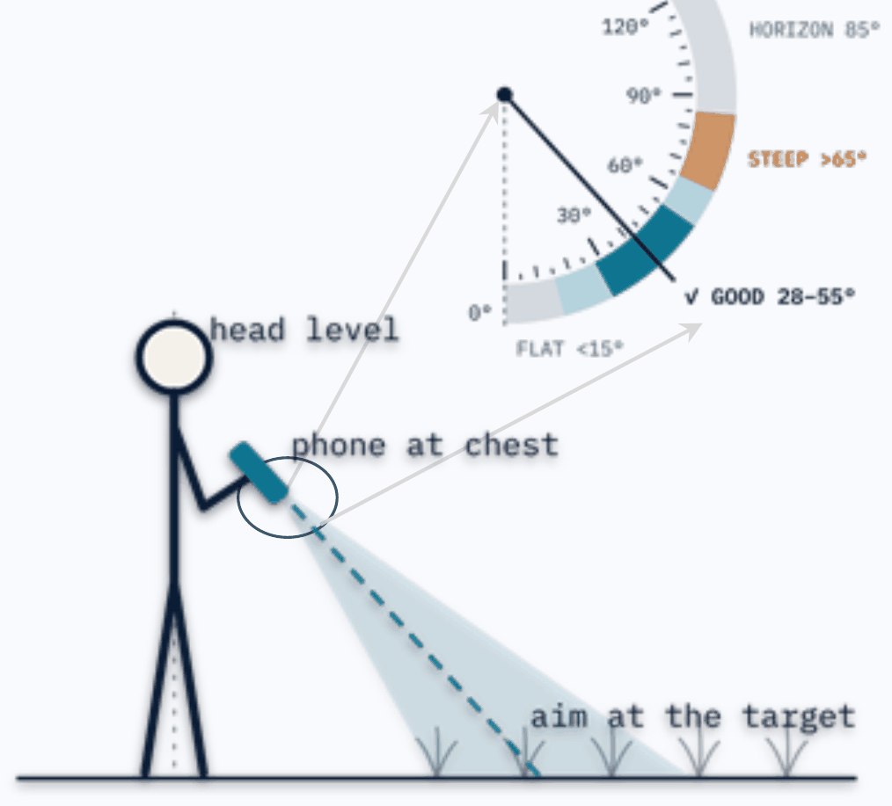
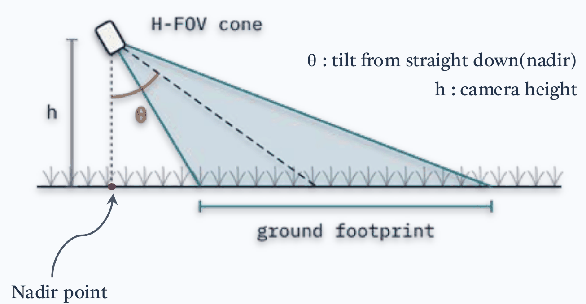

---
hide:
  - toc
description: "CropView: a field capture app that maps every photo as a ground footprint, with its location, look direction and tilt."
og:
  image: assets/images/cropview-card.png
  image_alt: "CropView: geo-tagged field capture app"
---

{ .cv-logo }

# CropView { .cv-wordmark }

Let the place speak in coordinates and geometries.

Camera · GPS · Compassv3.6Web + Android

A field capture app that turns every photo into a mapped ground footprint, with its location, look direction and tilt.

[Launch App →](https://somdeepkundu.github.io/cropview-v3/){ .md-button .md-button--primary }
[Data Explorer](https://somdeepkundu.github.io/cropview-v3/cropview-viewer-v2.html){ .md-button }
[Field Manual (PDF)](../assets/files/CropView_Field_Manual_v3.4.pdf){ .md-button }
[GitHub](https://github.com/somdeepkundu/cropview-v3){ .md-button }

## In the field

01 :material-cellphone-check:

**Open & allow**

Tap “Grant Permissions & Continue” and allow camera, location and compass.

02 :material-clipboard-text-outline:

**Start a session**

Name the project. Standing? Keep the camera height at 1.5 m.

03 :material-crosshairs-gps:

**Wait for GPS**

Stand in the open until the GPS button turns blue. Direction off? Tap the compass.

04 :material-sprout-outline:

**Aim**

Tilt until the side bar shows ✓ GOOD. Crop surveys: pick the Kc stage in DATA first.

05 :material-camera-iris:

**Capture**

Hold still and tap CAPTURE. Location, look direction and tilt are saved.

06 :material-map-outline:

**Map**

See your camera POV and ground footprint on the map.

07 :material-package-variant-closed:

**Export**

Before closing, open DATA, scroll down and tap EXPORT ZIP.

08 :material-map-search-outline:

**Explore**

Open the ZIP in the [Data Explorer](#data-explorer), guide below.

## Capture geometry

<figure markdown>

<figcaption>Each photo is mapped as a ground footprint.</figcaption>
</figure>

<figure markdown>

<figcaption>Phone at chest, 28–55° from nadir reads ✓ GOOD.</figcaption>
</figure>

<figure markdown>

<figcaption>h: camera height · θ: tilt from nadir.</figcaption>
</figure>

Every frame carries
`lat` `lon` `azimuth` `tilt` `altitude` `acc_h` `fp_w_m` `fp_d_m` `heading_source`

Filename
`ProjectName_ID_YYYYMMDDHHMMSS_lat_lon.jpg`

## Data Explorer

Map, browse and label your exported ZIPs in the browser. <a href="https://somdeepkundu.github.io/cropview-v3/cropview-viewer-v2.html">Open the Data Explorer →</a>

01 :material-folder-zip-outline:

**Load ZIPs**

Drop one or more exported ZIPs on the upload box. Each ZIP becomes its own colour-coded set.

02 :material-map-marker-radius-outline:

**Read the map**

Click a point to see its photo and footprint. Switch layers on or off: footprint, azimuth arrow, FOV cone, capture path.

03 :material-palette-outline:

**Colour & align**

Colour points by project, azimuth, tilt, altitude or index. Arrows look off? Turn them with Rotation Offset.

04 :material-image-multiple-outline:

**Browse & zoom photos**

Open any photo full screen. Pinch, scroll or double-tap to zoom, and drag to look around. On phones, swipe for the next photo.

05 :material-tag-outline:

**Annotate**

On the Annotate tab, select points, type a 2-digit class code and tap Apply to selected. 1st digit: crop or land type. 2nd: growth stage.

06 :material-download-outline:

**Export & resume**

Export Annotated GeoJSON; it opens in QGIS. Import it later to pick up where you left off.

Photo viewer: <kbd>←</kbd> <kbd>→</kbd> move · <kbd>Space</kbd> next · <kbd>+</kbd> <kbd>−</kbd> zoom · <kbd>0</kbd> fit · <kbd>I</kbd> info · <kbd>Esc</kbd> close

The <a href="../../assets/files/CropView_Field_Manual_v3.4.pdf">field manual</a> is a two-page print, with the field steps in English, हिन्दी, मराठी, தமிழ் and বাংলা.

---

Made by <a href="https://somdeepkundu.github.io/">Somdeep Kundu</a> with ❤️ at RuDRA Lab, C-TARA, IIT Bombay · RGSTC Project · MIT License

