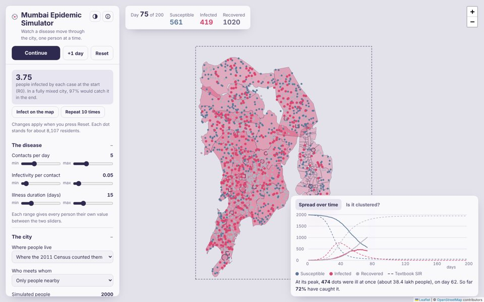

---
hide:
  - toc
description: "Mumbai Epidemic Simulator: watch an epidemic spread person by person across the real map of Mumbai, Thane and Navi Mumbai. Agent-based SIR, Monte Carlo, semivariogram and Moran's I, in the browser."
---

# Mumbai Epidemic Simulator

An agent-based SIR epidemic on the real map of Mumbai, Thane, Navi Mumbai and Mira-Bhayandar. Each dot is one person, placed where the 2011 Census counted people. They roam near home, many travel to a job centre each working day, meet people nearby, fall ill, recover and may lose immunity. The app compares the result with the classic SIR equations and measures how clustered the epidemic is in space.

[Open the simulator →](https://somdeepkundu.github.io/epidemic-sim/){ .md-button .md-button--primary }
[Model code (model.js)](https://somdeepkundu.github.io/epidemic-sim/model.js){ .md-button }

## What you can do

- **Real population.** People are placed by the 2011 Census population of each of Mumbai's 24 wards, plus Thane, Navi Mumbai and Mira-Bhayandar, with a slider for the share living in slum clusters. Each dot stands for about 8,000 residents.
- **Commuting and migration.** A share of people travel to a job centre from 9 am to 6 pm, chosen by a gravity model with a typical commute distance. Infected travellers can arrive at the main stations and the airport, and commuting can be stopped from any day.
- **Watch it spread on the map.** Shade each ward by the share infected, or turn on 1 km hotspots or each infected person's contact radius.
- **Start it anywhere.** The first cases begin at IIT Bombay; press *Infect on the map* and tap any place to add cases there.
- **Nearby or well mixed.** Spatial mode passes the disease only to people within the contact radius. Well-mixed mode lets anyone meet anyone, as in the textbook SIR model.
- **Different people, different values.** Contacts per day, infectivity and illness duration each take a min–max range, and every person draws their own value.
- **Interventions.** Vaccinate a share of people at the start, or let immunity wane so the epidemic can return (SIRS).
- **Monte Carlo.** Press *Repeat 10 times* and see how much chance alone changes the peak and its timing. Every run is reproducible from its seed.
- **Spatial statistics.** An indicator semivariogram and Moran's I of “ever infected” show whether neighbours share infection status.
- **Export.** The epidemic curve as CSV, and every person's position and state as GeoJSON for QGIS or Python.

## Methods

| Part | Method | Reference |
|---|---|---|
| Compartments | Susceptible → Infected → Recovered | Kermack & McKendrick (1927), *Proc. R. Soc. A* 115 |
| Check of well-mixed mode | Final-size relation z = 1 − e−R0·z | Kermack & McKendrick (1927) |
| Stochastic simulation | Monte Carlo, 0.1-day steps, seeded Mulberry32 generator | Metropolis & Ulam (1949), *JASA* 44 |
| Contacts per step | Poisson numbers by Knuth's method | Knuth (1997), *TAOCP* Vol. 2 |
| Mean-field model | SIR ordinary differential equations by Euler's method | — |
| Neighbour search | Uniform grid (cell list) with cells the size of the contact radius | — |
| Land | Land polygons rasterised to a 100 m mask by scanline filling | OpenStreetMap, DataMeet |
| Population | Ward census counts spread over 100 m land cells, split between slum and other cells | Census of India 2011; DataMeet |
| Commuting | Gravity model, P(job centre j) ∝ wj·e−d/β | Wilson (1971), *Environment and Planning A* 3 |
| Arrivals | Poisson stream of infected travellers at stations and the airport | — |
| Clustering | Indicator semivariogram, Matheron estimator | Matheron (1963), *Economic Geology* 58 |
| Clustering | Global Moran's I with distance-band weights | Moran (1950), *Biometrika* 37 |

With the lab defaults (R0 = 3.75) the well-mixed mode infects about 96–98% of people, against 97.4% from the final-size relation.

## Limits

This is a teaching and exploration tool, not a forecast. Populations are from 2011 and spread evenly within each ward apart from slum clusters. The Thane outline is approximate, because no open boundary was found. Job centres and their sizes are illustrative, and local trains are not modelled route by route.

## Data

Ward populations from the Census of India 2011 Primary Census Abstract, collated by ward in [Mumbai-Population-Map](https://github.com/mickeykedia/Mumbai-Population-Map). Ward, Navi Mumbai, Mira-Bhayandar and slum cluster boundaries from [DataMeet Municipal Spatial Data](https://github.com/datameet/Municipal_Spatial_Data), CC BY-SA 2.5 India. The script that builds the population grid is in `tools/epidemic-sim/` in this site's repository.

Made by <a href="https://somdeepkundu.github.io/">Somdeep Kundu</a>, a PhD student of IIT Bombay working on Agriculture and Rural Water Management using Earth Observation and bottom-up ground data. Ideas or bugs? Write to <a href="mailto:somdeepkundu@gmail.com?subject=Mumbai%20Epidemic%20Simulator">somdeepkundu@gmail.com</a>. Map © OpenStreetMap contributors. Code under the MIT licence. Version 1.1.1 · earlier: <a href="https://somdeepkundu.github.io/epidemic-sim/v1.1/">v1.1</a>, <a href="https://somdeepkundu.github.io/epidemic-sim/v1.0/">v1.0</a>

