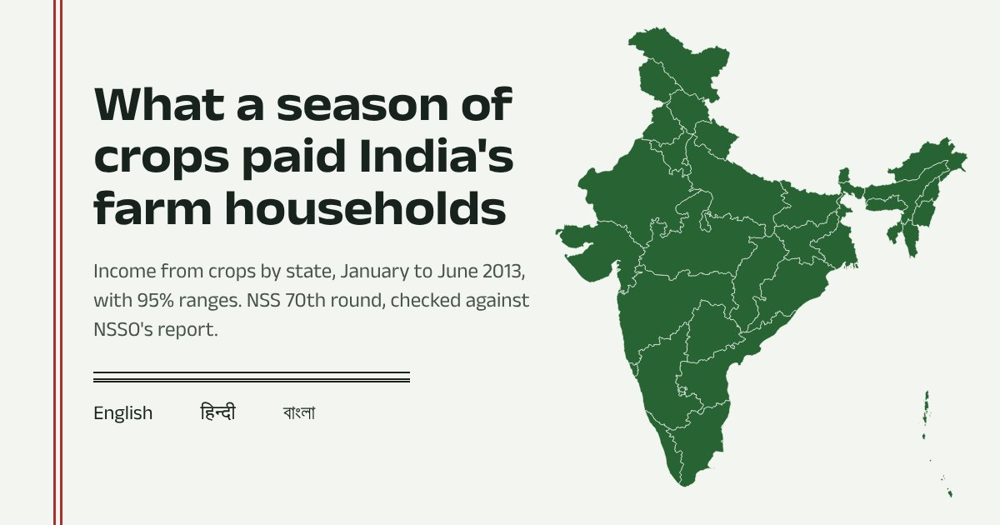

---
hide:
  - toc
description: "Farm income by state, 2013: what India's agricultural households earned from crops in January–June 2013, with 95% ranges, from NSS 70th round microdata. In English, Hindi and Bengali, with an open toolkit for any MoSPI survey."
---

# Farm income by state, 2013

What did a season of crops pay India's farm households? This page answers that for every state, from the household records of the NSS 70th round Situation Assessment Survey (Visit 2, January to June 2013). It is written for people who make or advise on farm policy: every figure comes with its 95% range, and the All-India numbers are checked against NSSO's own published report before they go up.

[Open the page](https://somdeepkundu.github.io/farm-income/){ .md-button .md-button--primary }
[Toolkit on GitHub](https://github.com/somdeepkundu/mospi-microdata-kit){ .md-button }

## What is on the page

- **The All-India account.** The value of crops grown, minus what was paid out for seed, fertiliser, hired labour and other inputs, gives the net receipt for six months. It comes with its range, a monthly equivalent and the median.
- **Four measures on one map.** Net receipt per household that grew crops, net receipt per agricultural household (NSSO's definition), the share that grew crops, and the share that paid out more than their harvest was worth.
- **States ranked with their ranges.** A dot for each estimate and a line for its 95% range, with the All-India line for reference. Plain sample averages can be switched on to show what survey weights correct.
- **Honest about small samples.** Estimates with a wide range are hatched and marked "use with caution". States with fewer than 30 sample households that grew crops are not estimated at all.
- **Before you quote these numbers.** Six plain sentences on what the figures are not: not household income, paid-out costs only, one season, 2013 rupees.
- **Take it away.** The full table as CSV, all figures as JSON, a print-ready brief, a citation, and a link to any state.
- **English, हिन्दी and বাংলা.** Each language is one file, so others can be added without touching the code.

## How the numbers are made

The [mospi-microdata-kit](https://github.com/somdeepkundu/mospi-microdata-kit) toolkit downloads the survey files from microdata.gov.in. It keeps within the portal's rate limit, retries when the portal is busy, checks each file and records its SHA-256. It then builds one record per household and estimates each state with NSSO's weights. The standard errors are Taylor-linearised, so they allow for villages being sampled within districts. Before anything is written, the All-India results are compared with NSSO's report *Key Indicators of Situation of Agricultural Households in India* (2014). Only state-level aggregates leave the notebook; household records are never published.

The same toolkit downloads any other MoSPI survey (PLFS, HCES, the 77th round) from a Colab notebook that needs no coding.

`NSS 70th round` `Survey weights` `Confidence intervals` `Choropleth` `Bilingual` `Python` `Colab`
