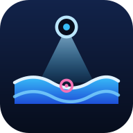
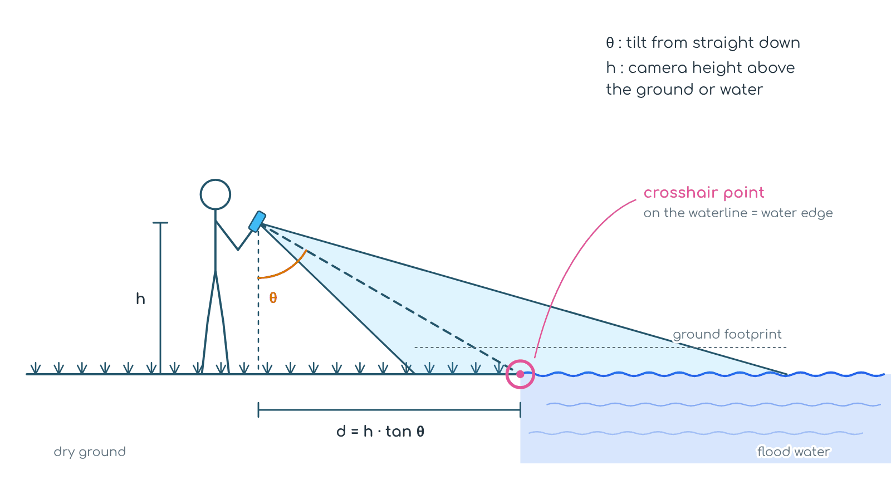
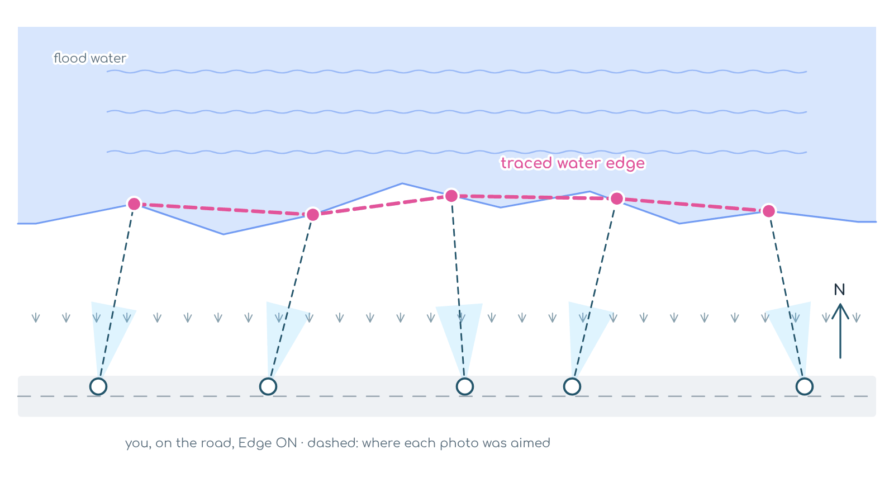
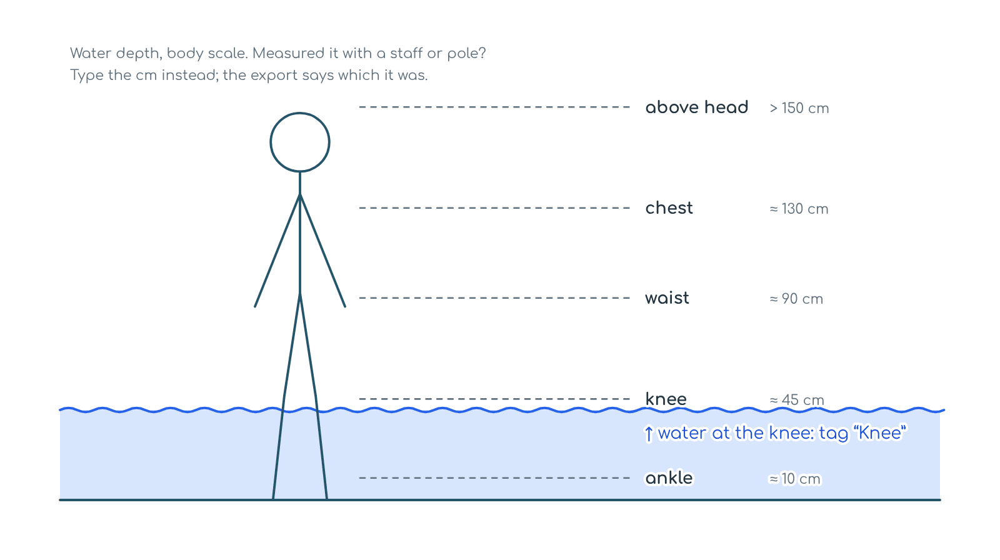

---
hide:
  - toc
title: "FloodView, launched on DRR Day 2026"
description: "Launched on the International Day for Disaster Risk Reduction (13 Oct 2026): FloodView, a free field camera for flood ground truthing. One tap labels a geo-tagged photo flooded, waterlogged or dry, with depth, flow and the waterline."
og:
  image: assets/images/floodview-drr-card.jpg
  image_alt: "FloodView launching on International Day for Disaster Risk Reduction, 13 October 2026"
---

{ .fv-logo }

# FloodView { .fv-wordmark }

Ground truth for flood maps, from where you stand.

Camera · GPS · Compassv1.1During + after floodWorks offlineDRR Day 2026

13 Oct 2026 International Day for Disaster Risk Reduction

**We are pleased to announce FloodView** on this year's DRR Day, themed [Resilience Starts at Home](https://www.undrr.org/news/undrr-announces-resilience-starts-home-theme-2026-international-day-disaster-risk-reduction). In a flood, the first people to see the water are the people at home. FloodView lets them record it as data that a flood map can be checked against.

**Why it's needed.** Satellite flood maps come fast, but they often miss water in built-up areas, under trees and beneath clouds, and are rarely checked on the ground. Field photos exist, but they sit in phones and chat groups without position or direction. FloodView turns each one into a mapped, labelled observation.

▸ Why it matters

- **Checks the map.** Points labelled flooded, waterlogged or dry show where a flood map is right and where it is wrong.
- **Marks the edge safely.** The crosshair records where the water starts, so nobody has to stand in it.
- **Works when networks fail.** Capture offline, keep full-size photos on the phone, and share one ZIP when the signal returns.
- **Open by default.** Free and open source. GeoJSON and CSV open in QGIS, with no account or server.

A field camera for flood ground truthing. One tap saves a geo-tagged photo labelled flooded, waterlogged or dry, with its look direction, ground footprint and the exact spot under the crosshair, so you can mark the waterline from dry ground. After the flood, it records flood marks and damage.

[Launch App →](https://somdeepkundu.github.io/floodview/){ .md-button .md-button--primary }
[Explorer](https://somdeepkundu.github.io/floodview/explorer.html){ .md-button }
[GitHub](https://github.com/somdeepkundu/floodview){ .md-button }
[Sibling: CropView](cropview.md){ .md-button }

:material-alert-outline:

**Stay safe.** Never wade into moving water: 15 cm of fast water can knock an adult over, and 30 cm can carry a car away. The crosshair point is there so you can tag water without standing in it.

## In the field

01 :material-cellphone-check:

**Open & allow**

Tap “Grant Permissions & Continue” and allow camera, location and motion sensors.

02 :material-clipboard-text-outline:

**Name the survey**

Set the camera height above the ground, or above the water if you're in it, on a boat or on a bridge.

03 :material-crosshairs-gps:

**Wait for GPS**

Stand in the open until the GPS button turns green. Direction off? Tap the compass and draw a figure-8.

04 :material-tag-multiple-outline:

**Set the tags**

Depth, flow, rising or receding, and what's flooded. They stay on until you change them.

05 :material-gesture-tap-button:

**Tap the class**

<b class="fl">FLOODED</b>, <b class="wl">WATERLOGGED</b> or <b class="dr">DRY</b>: one tap saves the photo with that label.

06 :material-vector-polyline:

**Trace the edge**

Switch <b class="ed">〰 Edge</b> on and put the crosshair on the waterline. Walk the boundary from dry ground.

07 :material-pencil-outline:

**Fix on the spot**

On the DATA tab, tap EDIT on any capture to change its class, tags, edge flag or note.

08 :material-share-variant-outline:

**Export & share**

Tap EXPORT ZIP, or SHARE ZIP straight to WhatsApp or Drive. Then open it in the [Explorer](#explorer).

## After the flood

Pick <b>After flood</b> when you start a survey. The buttons change to:

📏 :material-ruler:

**Flood mark**

The water line left on walls and trees. Note its height above the ground.

🏚 :material-home-alert-outline:

**Damage**

What is damaged (house, road, bridge, crops, embankment, well, power line…) and how bad: minor, major or destroyed.

✅ :material-check-circle-outline:

**Not flooded**

Places that stayed dry. Just as useful for checking a flood map.

You can also note the mud left behind and how long the water stayed. Every point gets a simple <code>was_flooded</code> yes/no, so during- and after-flood surveys go on one map.

## Capture geometry

<figure markdown>

<figcaption>The crosshair lands h · tan θ ahead. On the waterline, that spot is the water edge.</figcaption>
</figure>

<figure markdown>

<figcaption>Edge points join in capture order to trace the flood boundary.</figcaption>
</figure>

<figure markdown>

<figcaption>Depth on a body scale, or a measured value in cm.</figcaption>
</figure>

The crosshair point is most reliable with the phone tilted 40–80° from straight down, the green band on the tilt bar. Each capture also stores its ± uncertainty. Look direction, tilt and footprint use the same sensor code as CropView.

Every capture carries
`flood_class` `water_depth_class` `water_depth_cm` `flow` `level_trend` `flooded_land_cover` `water_edge` `heading_deg` `tilt_deg_from_nadir` `aim_lat` `aim_lon` `aim_uncertainty_m` `gps_accuracy_m`

In the ZIP
`images/` `*_captures_points.geojson` `*_captures_footprints.geojson` `*_water_edge.geojson` `*_captures.csv`

Filename
`Survey_FV-ID_YYYYMMDDHHMMSS_lat_lon.jpg`

## Explorer

Map, review and export your ZIPs in the browser, on a phone or a desktop. <a href="https://somdeepkundu.github.io/floodview/explorer.html">Open the Explorer →</a>

01 :material-folder-zip-outline:

**Load ZIPs**

Drop one or more ZIPs on the map. Each survey gets its own colour. CropView ZIPs open too.

02 :material-map-marker-radius-outline:

**Read the map**

Click a point to see its photo. Layers: footprints, crosshair points, water-edge trace, arrows, cones, walking path.

03 :material-palette-outline:

**Colour & filter**

Colour points by class, depth, flow, level trend or capture time. Hide a class, or show only edge points.

04 :material-image-multiple-outline:

**Browse & zoom photos**

Open any photo full screen. Pinch, scroll or double-tap to zoom, and drag to look around. On phones, swipe for the next photo.

05 :material-clipboard-check-outline:

**Review**

Fix the class, depth or edge flag in the table, on the map or in the photo viewer. The original field labels stay beside your edits.

06 :material-download-outline:

**Export & resume**

Export reviewed points, water edges or a CSV; the GeoJSON opens in QGIS. Reopen the same ZIPs later and your edits come back.

Photo viewer: <kbd>←</kbd> <kbd>→</kbd> move · <kbd>Space</kbd> next · <kbd>+</kbd> <kbd>−</kbd> zoom · <kbd>0</kbd> fit · <kbd>I</kbd> info · <kbd>Esc</kbd> close

<strong>No network in the flood zone?</strong> Open the app once with internet and it then works offline. Photos are kept full-size on the phone, saved surveys can be resumed, and map tiles you've already viewed stay available. Add it to your home screen for a full-screen app.

---

Made by <a href="https://somdeepkundu.github.io/">Somdeep Kundu</a> with ❤️ at RuDRA Lab, C-TARA, IIT Bombay · Sibling of <a href="../cropview/">CropView</a> · MIT License

