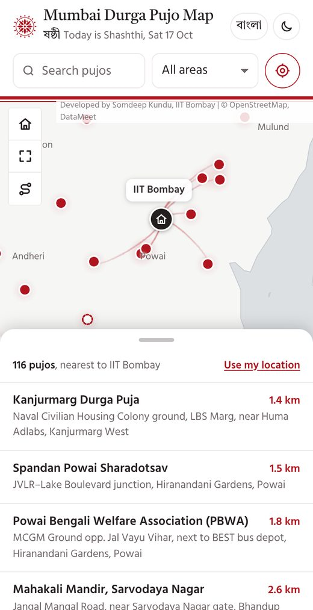

---
hide:
  - toc
description: "Mumbai Durga Pujo Map: 115 Durga Pujos across Mumbai, Thane and Navi Mumbai, nearest first, with directions. In English and Bangla."
og:
  image: assets/images/pujo-map-card.jpg
  image_alt: "Ma Durga's eyes drawn in red, with the words Mumbai Durga Pujo Map"
---

<svg class="pm-mark" viewBox="-50 -50 100 100" fill="currentColor" aria-hidden="true"><circle r="4.2"/><g><path d="M0-7C6-13 6-25 0-33C-6-25-6-13 0-7Z"/><path transform="rotate(45)" d="M0-7C6-13 6-25 0-33C-6-25-6-13 0-7Z"/><path transform="rotate(90)" d="M0-7C6-13 6-25 0-33C-6-25-6-13 0-7Z"/><path transform="rotate(135)" d="M0-7C6-13 6-25 0-33C-6-25-6-13 0-7Z"/><path transform="rotate(180)" d="M0-7C6-13 6-25 0-33C-6-25-6-13 0-7Z"/><path transform="rotate(225)" d="M0-7C6-13 6-25 0-33C-6-25-6-13 0-7Z"/><path transform="rotate(270)" d="M0-7C6-13 6-25 0-33C-6-25-6-13 0-7Z"/><path transform="rotate(315)" d="M0-7C6-13 6-25 0-33C-6-25-6-13 0-7Z"/></g><g><circle transform="rotate(22.5)" cy="-24" r="2.6"/><circle transform="rotate(67.5)" cy="-24" r="2.6"/><circle transform="rotate(112.5)" cy="-24" r="2.6"/><circle transform="rotate(157.5)" cy="-24" r="2.6"/><circle transform="rotate(202.5)" cy="-24" r="2.6"/><circle transform="rotate(247.5)" cy="-24" r="2.6"/><circle transform="rotate(292.5)" cy="-24" r="2.6"/><circle transform="rotate(337.5)" cy="-24" r="2.6"/></g><circle r="37" fill="none" stroke="currentColor" stroke-width="2.2"/></svg>

<h1>Mumbai Durga Pujo Map</h1>

মুম্বই দুর্গাপুজো ম্যাপ

115 Durga Pujos across Mumbai, Thane and Navi Mumbai. Nearest first, with directions.

[Open the map →](https://somdeepkundu.github.io/pujo-map/){ .md-button .md-button--primary }
[Data (CSV)](https://somdeepkundu.github.io/pujo-map/mumbai-durga-pujas-2026.csv){ .md-button }
[Data (GeoJSON)](https://somdeepkundu.github.io/pujo-map/mumbai-durga-pujas-2026.geojson){ .md-button }

<figure markdown>

<figcaption>Pujos near IIT Bombay, with a soft glow where they cluster.</figcaption>
</figure>
<figure markdown>

<figcaption lang="bn">বাংলায়, ডার্ক মোডে, ঠাকুর দেখার রুট সহ।</figcaption>
</figure>

**Nearest first**

Distances from IIT Bombay, or from you. Directions open in Google Maps for walking or by car, with each pujo's Instagram or Facebook page where it has one. Tap a pujo and its nearest neighbours' names appear beside it, or turn on pujo names for the whole map.

**Pandal-hopping route**

The shortest walk through 4 pujos close by, drawn as a calm trail, ready to open in Google Maps.

**Today, by the Bengali calendar**

A slim 24-hour strip shows the tithi now and when the next begins, by the traditional Bengali panjika, with sunrise, sunset and the Bengali date. In English and বাংলা.

Know a missing pujo, a wrong pin or a pujo's Instagram page? Write to <a href="mailto:somdeepkundu@gmail.com?subject=Mumbai%20Durga%20Pujo%20Map">somdeepkundu@gmail.com</a> or message me on <a href="https://www.linkedin.com/in/somdeep-kundu/">LinkedIn</a> or <a href="https://www.instagram.com/somdeeplearning/">Instagram</a>.

Bengali fonts from <a href="https://github.com/fahimscirex/bangla-fonts">bangla-fonts</a>. Alpona art by <a href="https://www.instagram.com/the_nocturnal_mystic/">Parama Ghosh</a>, traced from her hand-painted alponas. Dhak sound from <a href="https://youtu.be/VksCiC7qz2c">this YouTube video</a>.

Made by <a href="https://somdeepkundu.github.io/">Somdeep Kundu</a>, IIT Bombay · Durga Puja 2026 · v1.7.1 · earlier: <a href="https://somdeepkundu.github.io/pujo-map/v1.6/">v1.6</a>, <a href="https://somdeepkundu.github.io/pujo-map/v1.5/">v1.5</a>, <a href="https://somdeepkundu.github.io/pujo-map/v1.4/">v1.4</a>, <a href="https://somdeepkundu.github.io/pujo-map/v1.3/">v1.3</a>, <a href="https://somdeepkundu.github.io/pujo-map/v1.2/">v1.2</a>, <a href="https://somdeepkundu.github.io/pujo-map/v1.1/">v1.1</a>, <a href="https://somdeepkundu.github.io/pujo-map/v1/">v1</a>

