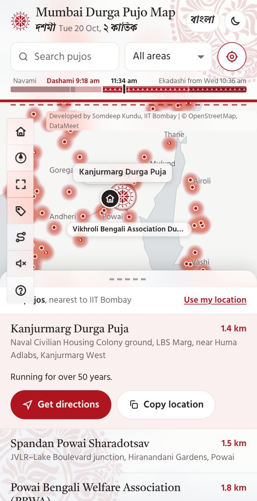
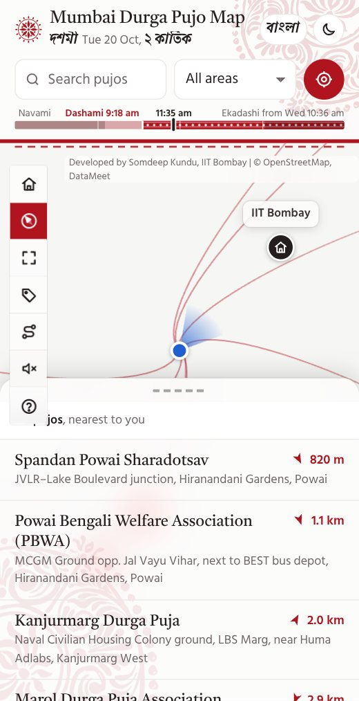
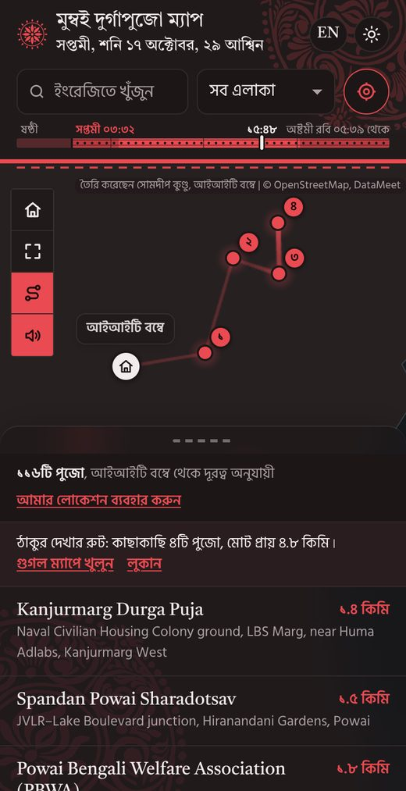
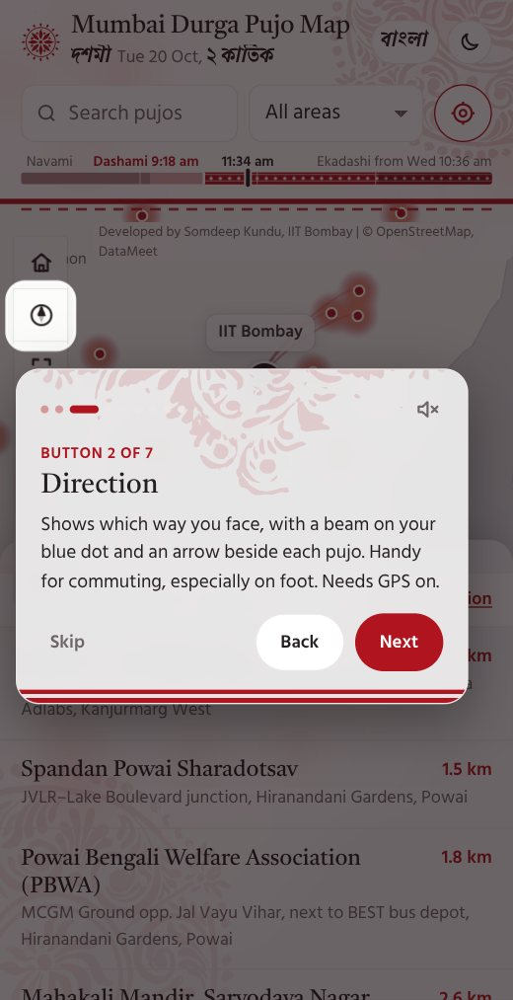

---
hide:
  - toc
description: "Mumbai Durga Pujo Map: 115 Durga Pujos across Mumbai, Thane and Navi Mumbai, nearest first, with directions. In English and Bangla."
og:
  image: assets/images/pujo-map-card.jpg
  image_alt: "Ma Durga's eyes drawn in red, with the words Mumbai Durga Pujo Map"
---

<svg class="pm-mark" viewBox="-50 -50 100 100" fill="currentColor" aria-hidden="true"><circle r="4.2"/><g><path d="M0-7C6-13 6-25 0-33C-6-25-6-13 0-7Z"/><path transform="rotate(45)" d="M0-7C6-13 6-25 0-33C-6-25-6-13 0-7Z"/><path transform="rotate(90)" d="M0-7C6-13 6-25 0-33C-6-25-6-13 0-7Z"/><path transform="rotate(135)" d="M0-7C6-13 6-25 0-33C-6-25-6-13 0-7Z"/><path transform="rotate(180)" d="M0-7C6-13 6-25 0-33C-6-25-6-13 0-7Z"/><path transform="rotate(225)" d="M0-7C6-13 6-25 0-33C-6-25-6-13 0-7Z"/><path transform="rotate(270)" d="M0-7C6-13 6-25 0-33C-6-25-6-13 0-7Z"/><path transform="rotate(315)" d="M0-7C6-13 6-25 0-33C-6-25-6-13 0-7Z"/></g><g><circle transform="rotate(22.5)" cy="-24" r="2.6"/><circle transform="rotate(67.5)" cy="-24" r="2.6"/><circle transform="rotate(112.5)" cy="-24" r="2.6"/><circle transform="rotate(157.5)" cy="-24" r="2.6"/><circle transform="rotate(202.5)" cy="-24" r="2.6"/><circle transform="rotate(247.5)" cy="-24" r="2.6"/><circle transform="rotate(292.5)" cy="-24" r="2.6"/><circle transform="rotate(337.5)" cy="-24" r="2.6"/></g><circle r="37" fill="none" stroke="currentColor" stroke-width="2.2"/></svg>

<h1>Mumbai Durga Pujo Map</h1>

মুম্বই দুর্গাপুজো ম্যাপ

115 Durga Pujos across Mumbai, Thane and Navi Mumbai. Nearest first, with a compass and directions.

[Open the map →](https://somdeepkundu.github.io/pujo-map/){ .md-button .md-button--primary }
[Data (CSV)](https://somdeepkundu.github.io/pujo-map/mumbai-durga-pujas-2026.csv){ .md-button }
[Data (GeoJSON)](https://somdeepkundu.github.io/pujo-map/mumbai-durga-pujas-2026.geojson){ .md-button }

<video controls playsinline preload="none" poster="../../assets/images/pujo-map-brag.jpg" aria-label="A 20 second tour of the Mumbai Durga Pujo Map">
<source src="../../assets/videos/pujo-map-brag.mp4" type="video/mp4">
</video>

The map in 20 seconds. Sound on for the dhak.

Anatomy of the list sheet: a drawer that clicks into peek, half and full, like the bottom sheet in the app. <a href="https://somdeepkundu.github.io/pujo-map/anatomy/">Try it interactively →</a>

<figure markdown>

<figcaption>Tap a pujo and its neighbours' names appear beside it.</figcaption>
</figure>
<figure markdown>

<figcaption>Compass on: a beam on your blue dot, an arrow beside each pujo.</figcaption>
</figure>
<figure markdown>

<figcaption lang="bn">বাংলায়, ডার্ক মোডে, ঠাকুর দেখার রুট সহ।</figcaption>
</figure>
<figure markdown>

<figcaption>A guided tour, with each map button explained one by one.</figcaption>
</figure>

**Nearest first**

Distances from IIT Bombay, or from you. Directions open in Google Maps for walking or by car, with each pujo's Instagram or Facebook page where it has one.

**Names and neighbours**

Tap a pujo and the names of its nearest neighbours appear beside it, joined by dotted lines. Or switch on pujo names for the whole map. Dots shrink as you zoom out, so the red glow of the crowded areas stays clear.

**Compass for walking**

Tap the compass and a beam on your blue dot shows which way you face, with a small arrow beside each pujo pointing the way to walk. Drifting? Draw a figure-8 with your phone. It needs GPS, and asks you to turn it on if it is off.

**Your own home**

Home is IIT Bombay, since the map began for the Bengali community there. Press and hold Home to make any spot in the region your home, and the distances follow. It is saved on your phone, with a one-tap reset.

**A guided tour**

A short welcome tour opens on your first visit, in English or Bangla, and the ? button brings it back. On the map-buttons step, Explain each button goes through them one by one. Skip and mute are always on the card.

**Pandal-hopping route**

The shortest walk through 4 pujos close by, drawn as a calm trail, ready to open in Google Maps.

**Highlights**

A ✦ marks the oldest and most historic pujos, such as the one running since 1953, and Kumari Puja at Ramakrishna Math. The Highlights button lists just those.

**Share a pujo**

Share sends a pujo's name, place and a Google Maps link through your phone's own share sheet, to WhatsApp or anyone.

**Install it, even offline**

Add it to your home screen like an app. After one visit it still opens when the network is patchy between pandals, with the map tiles you have already seen.

**Today, by the Bengali calendar**

A slim 24-hour strip shows the tithi now and when the next begins, by the traditional Bengali panjika, with sunrise, sunset and the Bengali date, in am and pm. In English and বাংলা.

**Light, dark and Bangla**

Switch between English and বাংলা, and between light and dark. The whole map, tour and notices follow, and the dhak plays softly unless you mute it.

**Open data**

All 115 pins are free to download as CSV or GeoJSON, with how each position was found marked as exact, venue or approximate.

Know a missing pujo, a wrong pin or a pujo's Instagram page? Write to <a href="mailto:somdeepkundu@gmail.com?subject=Mumbai%20Durga%20Pujo%20Map">somdeepkundu@gmail.com</a> or message me on <a href="https://www.linkedin.com/in/somdeep-kundu/">LinkedIn</a> or <a href="https://www.instagram.com/somdeeplearning/">Instagram</a>.

Bengali fonts from <a href="https://github.com/fahimscirex/bangla-fonts">bangla-fonts</a>. Alpona art by <a href="https://www.instagram.com/the_nocturnal_mystic/">Parama Ghosh</a>, traced from her hand-painted alponas. Dhak sound from <a href="https://youtu.be/VksCiC7qz2c">this YouTube video</a>.

Made by <a href="https://somdeepkundu.github.io/">Somdeep Kundu</a>, IIT Bombay · Durga Puja 2026 · v1.12 · earlier: <a href="https://somdeepkundu.github.io/pujo-map/v1.11.2/">v1.11.2</a>, <a href="https://somdeepkundu.github.io/pujo-map/v1.11.1/">v1.11.1</a>, <a href="https://somdeepkundu.github.io/pujo-map/v1.11/">v1.11</a>, <a href="https://somdeepkundu.github.io/pujo-map/v1.10.2/">v1.10.2</a>, <a href="https://somdeepkundu.github.io/pujo-map/v1.10.1/">v1.10.1</a>, <a href="https://somdeepkundu.github.io/pujo-map/v1.10/">v1.10</a>, <a href="https://somdeepkundu.github.io/pujo-map/v1.9.3/">v1.9.3</a>, <a href="https://somdeepkundu.github.io/pujo-map/v1.9.2/">v1.9.2</a>, <a href="https://somdeepkundu.github.io/pujo-map/v1.9.1/">v1.9.1</a>, <a href="https://somdeepkundu.github.io/pujo-map/v1.9/">v1.9</a>, <a href="https://somdeepkundu.github.io/pujo-map/v1.8/">v1.8</a>, <a href="https://somdeepkundu.github.io/pujo-map/v1.7/">v1.7</a>, <a href="https://somdeepkundu.github.io/pujo-map/v1.6/">v1.6</a>, <a href="https://somdeepkundu.github.io/pujo-map/v1.5/">v1.5</a>, <a href="https://somdeepkundu.github.io/pujo-map/v1.4/">v1.4</a>, <a href="https://somdeepkundu.github.io/pujo-map/v1.3/">v1.3</a>, <a href="https://somdeepkundu.github.io/pujo-map/v1.2/">v1.2</a>, <a href="https://somdeepkundu.github.io/pujo-map/v1.1/">v1.1</a>, <a href="https://somdeepkundu.github.io/pujo-map/v1/">v1</a>

