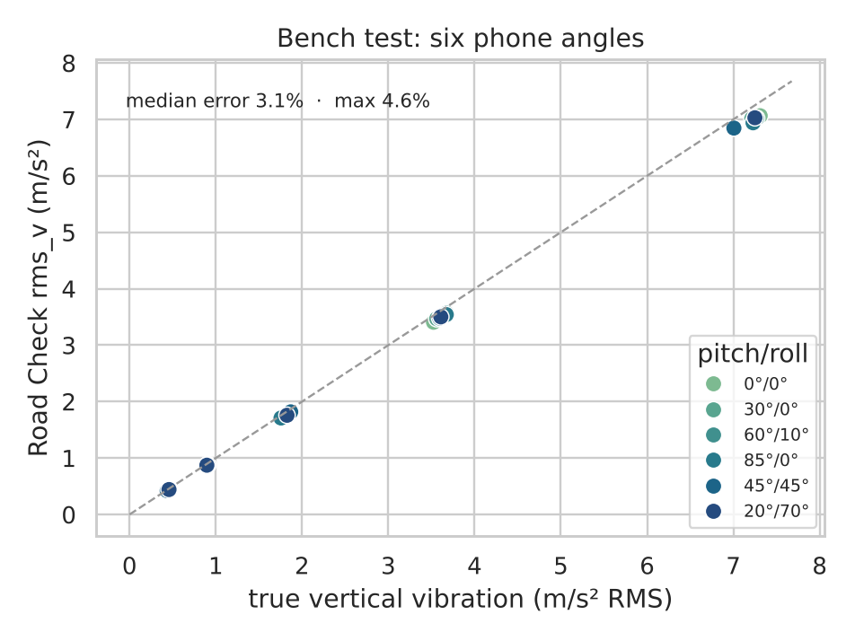

---
hide:
  - toc
title: "Road Check"
description: "A phone web app that logs road roughness while you ride: a score for every 20 m, sharp bumps, a coloured map and an LLM-ready ZIP. Works offline."
og:
  image: assets/images/road-check-card.png
---

{ .rc-logo }

# Road Check { .rc-wordmark }

How rough is the road? Ride it and find out.

Accelerometer · GPSv0.2.020 m stretchesWorks offlineExperimental

A phone web app that logs how rough the road is while you ride a motorbike, scooter, bicycle or car. It turns the phone's shake into a roughness score for every 20 m of road, marks sharp bumps, and colours the route on a map. One ZIP holds everything, including a ready brief for an LLM to look up road types, surfaces and speed breakers and make a report poster.

[Launch App →](https://somdeepkundu.github.io/geo-dev-skills-bysomdeep/apps/road-check/){ .md-button .md-button--primary }
[GitHub](https://github.com/somdeepkundu/geo-dev-skills-bysomdeep/tree/main/apps/road-check){ .md-button }
[Sibling: CropView](cropview.md){ .md-button }
[Sibling: FloodView](floodview.md){ .md-button }

:material-alert-outline:

**Ride first, data second.** Set the app up while you are stopped, then don't touch the phone on the move. Use a proper handlebar mount, never a hand.

## On the ride

01 :material-cellphone-arrow-down:

**Open once online**

Open the app with internet once. It then works with no network, and can be added to the home screen.

02 :material-map-outline:

**Save the map**

At home on wifi, tap “Save the map around me” for about 1.5 km of street map to use offline.

03 :material-motorbike:

**Pick vehicle & mount**

Choose the vehicle and where the phone sits. A handlebar mount gives the cleanest data; a pocket adds your own movement.

04 :material-play-circle-outline:

**Start ride**

Allow location and motion. Wait for “logging” and a GPS figure of ±10 m or better.

05 :material-brightness-4:

**Dim screen**

A locked phone stops the sensors, so the screen stays on but goes black and ignores touches. Hold the ring 2 s to wake it.

06 :material-flag-checkered:

**End ride**

Tap End twice. The summary shows distance, share of each road class, and the roughest stretches.

07 :material-folder-zip-outline:

**Export ZIP**

GeoJSON and CSV for QGIS, the raw readings, <code>datapackage.json</code> and <code>PROMPT.md</code>.

08 :material-robot-outline:

**Ask an LLM**

Tap “Copy LLM prompt”, or hand over the ZIP. The brief asks for a road-type analysis and a report poster.

## How it scores the road

| Step | What happens |
|---|---|
| **Vertical shake** | The phone's acceleration is projected on a slowly averaged gravity direction, so the phone can sit at any angle. |
| **20 m stretches** | The ride is cut by distance, not time, interpolated between GPS fixes. Each stretch gets `rms_v`, `peak_v`, bumps, speed and curve. |
| **Speed-adjusted index** | `rms_v × (30 km/h ÷ speed)`. Classes: smooth < 1.0 · fair < 2.0 · rough < 3.5 · very rough. |
| **No guessing** | Below 10 km/h, under 20 readings a second, or with weak GPS, a stretch is left unscored (empty, never 0). Standing still is trimmed. |
| **Sharp bumps** | Peaks over 4 m/s², merged within 0.25 s, saved as points. |

Raw readings are kept in 10 s chunks on the phone, either all of them or a rolling window of the last 5 or 30 minutes plus ±2 s around every bump. Nothing leaves the phone until you export.

## Validation

169 :material-check-all:

**Automated tests pass**

Checks on the maths and in a real browser, including a full ride with the network switched off.

±5% :material-angle-acute:

**Any phone angle**

Against known vibration, with the phone tilted six ways, readings stay within 5%.

3 :material-map-marker-path:

**Field rides**

Validated in rural Bengal and Mumbai. Rides in Delhi–Noida are going on.

<figure markdown>
{ style="max-width:460px" }
<figcaption>Bench test: every reading sits on the 1:1 line whatever the phone's angle.</figcaption>
</figure>

## Who it helps

| | |
|---|---|
| **Road policy makers & PWD / PMGSY engineers** | A cheap, repeatable roughness map to rank repairs and check new roads after handover. |
| **Municipalities & panchayats** | Evidence for budget asks, ward by ward or village by village. |
| **Researchers** | Open, explained data for road, transport and rural-access studies. |
| **Riders & citizens** | Rough stretches and speed breakers mapped from an everyday phone. |

## In the ZIP

Every 20 m stretch carries
`index` `class` `rms_v` `peak_v` `rms_lateral` `bumps` `speed_kmh` `heading_deg` `curve_radius_gps_m` `curve_radius_gyro_m` `rate_hz` `gps_acc_max_m` `flags`

Files
`data/*_segments.geojson` `data/*_segments.csv` `data/*_bumps.geojson` `raw/*_raw.csv` `ride.json` `datapackage.json` `PROMPT.md` `README.txt`

The LLM brief asks for
`OSM road type & surface` `speed breakers` `rain` `ranked stretches` `report poster`

Scan to open on a phone. Works on Android Chrome; on iPhone, Safari asks for motion permission when you start.

---

Made by <a href="https://somdeepkundu.github.io/">Somdeep Kundu</a> with ❤️ at RuDRA Lab, C-TARA, IIT Bombay · Built on the phone-field-sensors skill · MIT License

